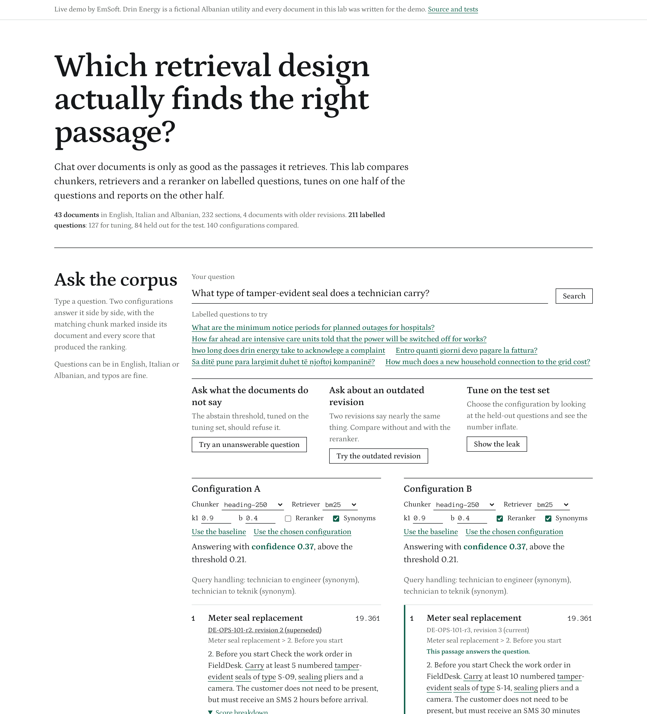
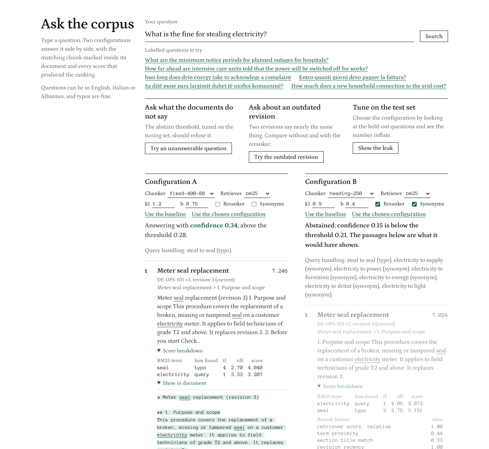
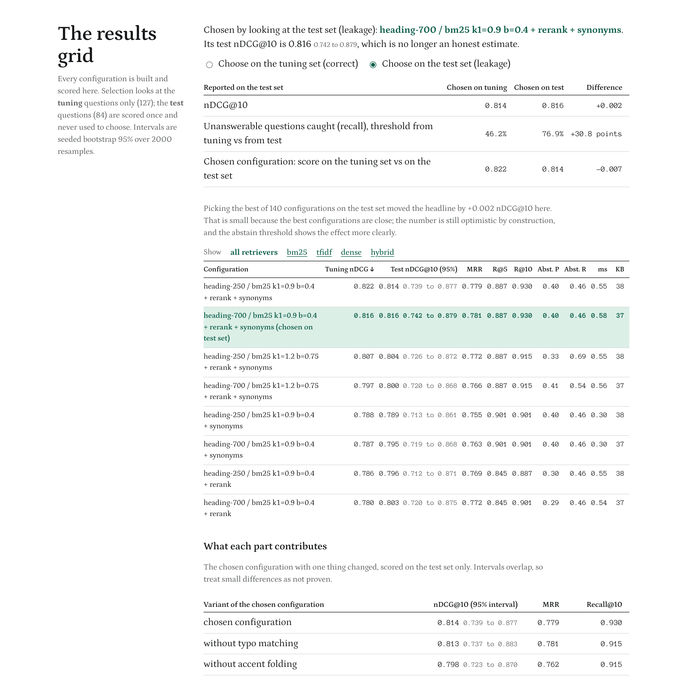
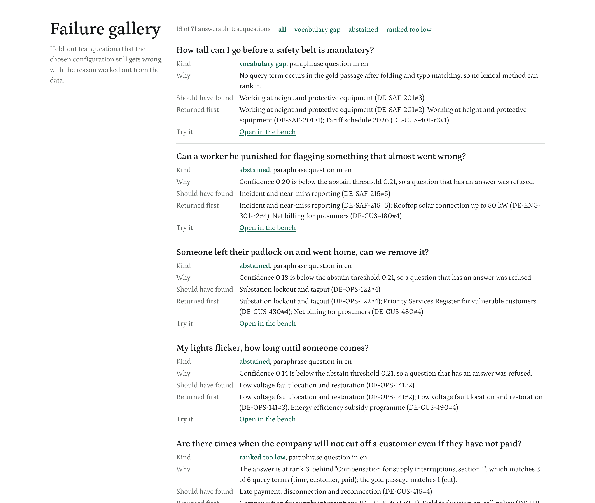
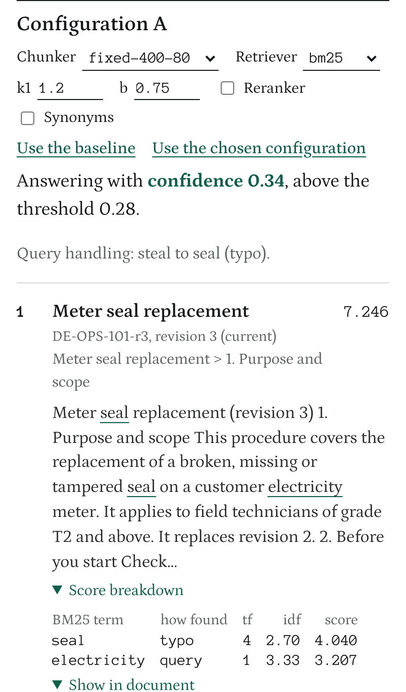

# Retrieval lab: measure which design finds the right passage

Chat over your documents only works if the right passage is retrieved first. This lab compares chunkers, retrievers and a reranker on labelled questions, chooses on one half, reports on the other half, and shows when the system should refuse to answer.

**▶ Live demo: https://enxo7899.github.io/rag-retrieval-lab/** (click "Try the outdated revision", then "Try an unanswerable question")



The demo context is **Drin Energy, a fictional Albanian utility**: 43 technical and customer-policy documents in English, Italian and Albanian, with tables, numbered procedures, near-duplicate versions and superseded revisions, plus 211 labelled questions. There is no language model: this is the retrieval half of a document chat, which is where most wrong answers start.

## What it does

| Capability | Detail |
|---|---|
| Chunkers | Fixed-size with overlap, sentence-window, heading-aware. Each chunk keeps document id, section path and character offsets. A chunk never splits a table row |
| Retrievers | BM25 with tunable k1 and b, TF-IDF cosine, a dense retriever (latent semantic analysis by power iteration, written from scratch) and hybrid with reciprocal rank fusion |
| Reranker | Term proximity, section-title match and revision recency on the top 20 |
| Query handling | Accent folding (Albanian e-diaeresis and c-cedilla), typo-tolerant matching, suffix matching, optional synonym expansion across the three languages |
| Metrics | Recall@5 and @10, MRR, nDCG@10, abstain precision and recall, seeded bootstrap 95% intervals, latency and index size |
| Honest evaluation | 127 tuning questions choose the configuration and the abstain threshold; 84 held-out test questions are only reported |
| Demo | Two configurations side by side with the matching chunk highlighted in its document, a sortable results grid, a failure gallery, and "try to break it" controls |

## Measured results

Everything below comes from `npm run evaluate` (writes `docs/results.json`, which the page reads). 140 configurations, seed 20261116, 2,000 bootstrap resamples. Latency is the median per question on the machine that ran it.

| Configuration | Tuning nDCG@10 | Test nDCG@10 (95% CI) | Test MRR | Test recall@10 |
|---|---|---|---|---|
| Baseline: fixed-400-80, BM25 (k1 1.2, b 0.75) | n/a | 0.619 (0.515 to 0.713) | 0.587 | n/a |
| Chosen on tuning: heading-250, BM25 (k1 0.9, b 0.4) + reranker + synonyms | 0.822 | **0.814 (0.739 to 0.877)** | 0.779 | 0.930 |

- **Chosen on tuning set, reported on test set.** The chosen configuration is 19.5 nDCG points above the baseline and the intervals do not overlap much. Index 38 KB for 258 chunks, median 0.55 ms per question in Node.
- **Best of each retriever on test** (each picked on tuning): BM25 0.814, TF-IDF 0.767, latent-space dense 0.607, hybrid (BM25 plus dense) 0.705. On this small corpus plain keyword search beats the from-scratch dense retriever, and fusing the two did not beat BM25 alone. That is a result, not a bug: LSA on 43 documents has little to learn from.
- **The reranker prefers the current revision.** On the 14 outdated-revision questions the superseded document was the top result 11 times without the reranker and 0 times with it.
- **Leakage.** Choosing by the test column picks a different configuration and moves test nDCG@10 by only +0.002 here, because the best configurations are within noise of each other. The abstain threshold leaks more: tuned on test, unanswerable questions caught goes from 46.2% to 76.9%.
- **Abstaining is the weak part.** On test, the threshold from tuning catches 46% of unanswerable questions with 40% precision and wrongly refuses 13% of answerable ones. A single confidence threshold is a blunt tool; see Limits.
- **What each part adds** (chosen configuration, test nDCG@10): without the reranker 0.789, without synonyms 0.796, without accent folding 0.798, without typo matching 0.813. All intervals overlap, so only the reranker and folding effects are plausible, not proven.





## How it works

```
 documents ─> chunker ─> BM25 | TF-IDF | LSA dense | hybrid (RRF) ─> top 20 ─> reranker ─> abstain if confidence < threshold
              3 kinds     question: fold, stop words, typo and suffix match, synonyms        proximity, title, recency
 tuning questions choose the configuration and threshold ─> test questions report it (bootstrap intervals)
```

`src/` is plain ES modules with no dependencies and no file access. `index.html` imports the same files that `npm test` and `npm run evaluate` run, so the page is not a mock-up. Gold labels are sections (for example `DE-CUS-415#3`), so every chunker is scored against the same answers. More in [docs/DESIGN.md](docs/DESIGN.md).





## Run it

Needs Node 22. No install step, no dependencies.

```bash
npm test               # 36 tests
npm run build          # rebuild data/corpus.json, data/queries.jsonl, data/lsa.json from data/docs and data/queries.src.txt
npm run evaluate       # run the 140-configuration grid, rewrite docs/results.json (about 45 seconds)
npm run dev            # demo at http://127.0.0.1:5188/
```

`?run=outdated`, `?run=unanswerable` and `?run=leak` open the demo in those scenarios; `?q=your question` asks one. CI runs `npm test` on every push, then deploys the demo.

## Adapt it to your business

- `data/docs/*.md`: replace with your documents. Front matter holds id, family (revisions of one document share it), revision, date and language; sections are `## 1. Title` headings.
- `data/queries.src.txt`: your labelled questions, one per line, with the answering section ids. Leave the gold field empty for questions your documents do not answer. Run `npm run build`.
- `src/synonyms.js`: your domain's synonym groups and languages.
- `src/chunkers.js` and `src/grid.js`: the chunk sizes and settings to compare.
- To test a real embedding model, implement `score(terms)` and `confidence(i)` like `src/lsa.js` and add it to `src/pipeline.js`.

## Limits

- The corpus and questions were written by the author for the demo, including the synonym table, so the synonym gain is optimistic. The documents are short, which flatters heading-aware chunking.
- 84 test questions give wide intervals (about plus or minus 0.07 nDCG). Differences under about 0.05 between configurations are not proven. Query types have 6 to 20 test questions each.
- The dense retriever is latent semantic analysis trained on 43 documents, not a neural embedding model, and it did not help. Do not read the result as "BM25 beats embeddings".
- One global abstain threshold is weak: questions that share a few words with the corpus (for example "who is the chief executive of Drin Energy") look confident, and terse answerable questions look unsure.
- Recency is a ranking nudge. It would also push a user who explicitly asks about an old revision towards the new one.
- Albanian inflection is handled by a small suffix list and synonym entries, not a stemmer. Questions in one language whose answer exists only in another language mostly fail.
- Latency and build time are measured in one Node process and vary by machine.
- The tuning split is used for both choosing the configuration and the threshold, and the grid of 140 configurations is searched on 127 questions, so the tuning score is slightly optimistic (0.822 against 0.814 on test).

---
Built by **[EmSoft](https://github.com/enxo7899)**: RAG and chat-with-your-documents systems that are measured, not guessed. Get in touch through my Fiverr or Upwork profile.
